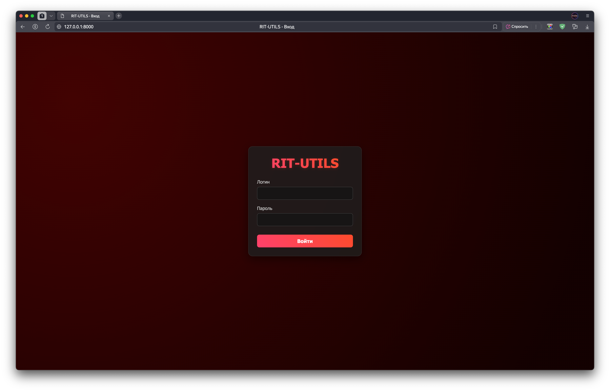
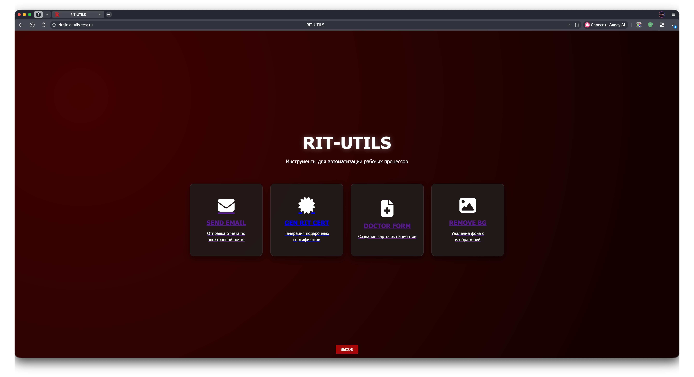
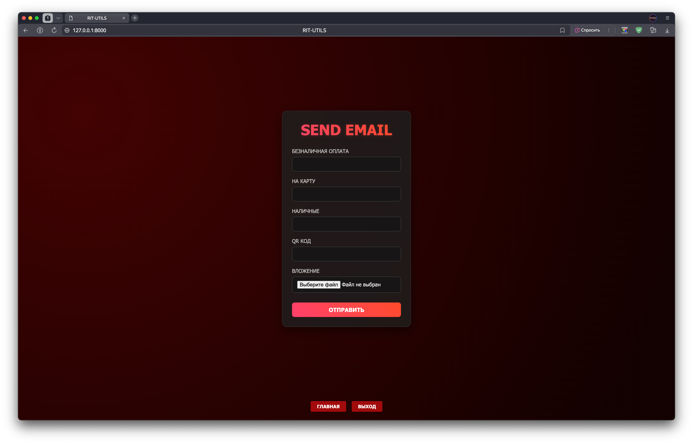
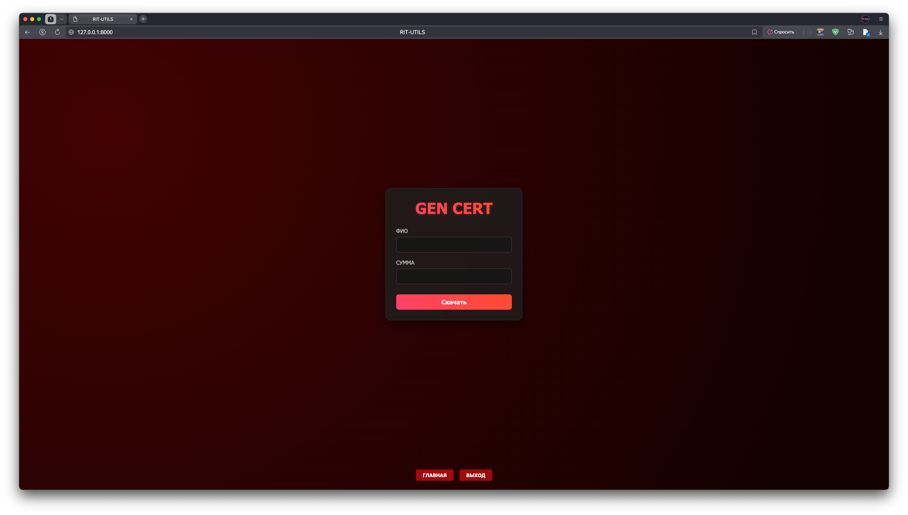
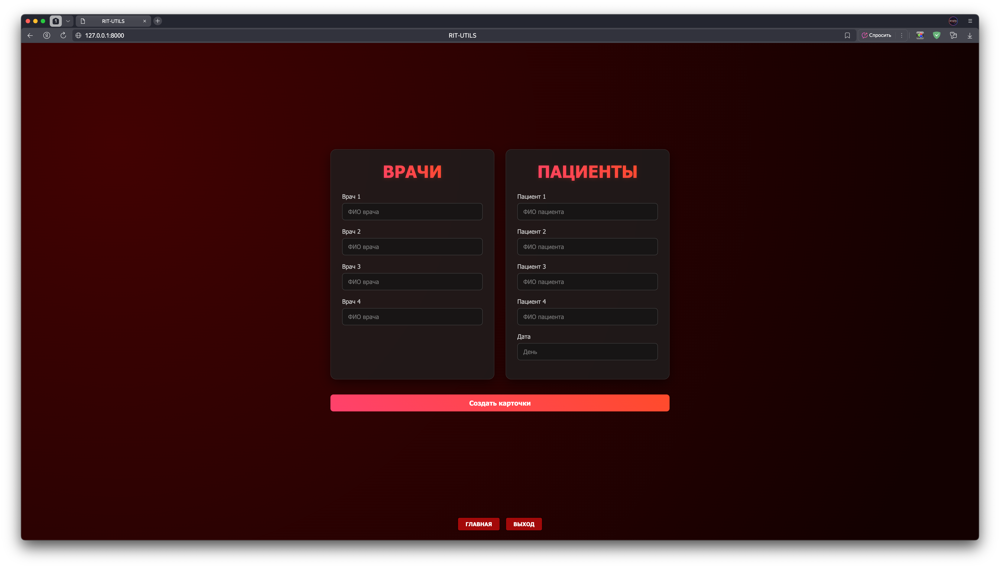
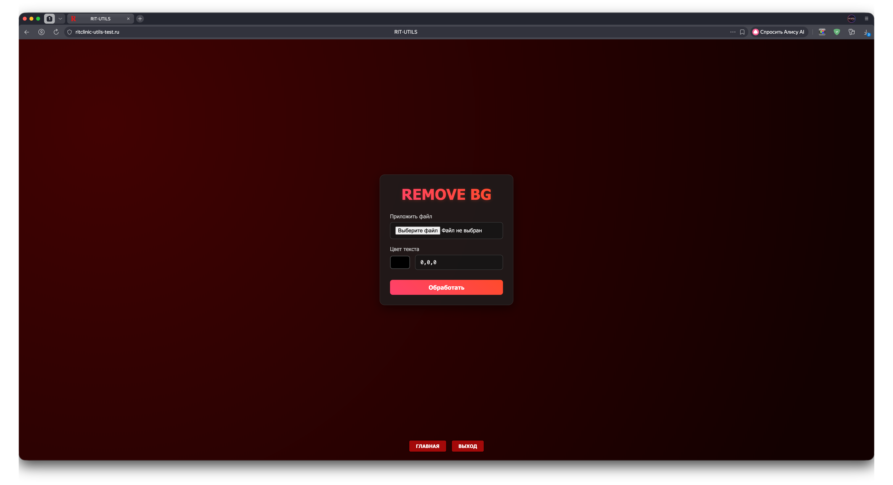

# rit-utils


Веб-приложение на FastAPI для автоматизации рабочих процессов.

## 📝 Описание

Проект предоставляет набор утилит для автоматизации рабочих процессов, включая:
- 🔐 Простую и безопасную авторизацию
- 📄 Генерацию сертификатов
- 🏥 Обработку форм
- 📧 Отправку email-уведомлений с вложениями
- 🛡️ JWT-авторизацию с refresh токенами

## 🔐 Безопасность

Приложение защищено системой аутентификации:
- **Логин/пароль** - авторизация пользователя
- **JWT токены** - защищенные сессии с автоматическим обновлением
- **Secure cookies** - защита от XSS и CSRF атак

## 🚀 Быстрый старт

### Требования
- Python 3.13
- uv 0.12.19 или новее (для управления зависимостями и виртуальным окружением)

### Установка
1. Клонируйте репозиторий:
   ```bash
   git clone https://github.com/PROSHANTI/rit-utils.git
   cd rit-utils
   ```

2. Установите зависимости:
   ```bash
   uv sync
   ```

   Команда создаёт виртуальное окружение `.venv` и устанавливает зависимости из
   `uv.lock`: пакеты для работы приложения и группу `dev` с линтерами и тестами.
   Для установки только рабочих зависимостей используйте `uv sync --no-dev`.

3. Добавьте необходимые файлы:
   Перед запуском добавьте требуемые файлы шаблонов в соответствующие директории (см. раздел "Дополнительные файлы").

4. Настройте переменные окружения:
   ```bash
   cp .env.examples .env
   nano .env
   ```

   **Обязательно настройте:**
   - `LOGIN` и `PASSWORD` - учетные данные для входа
   - `SEND_FROM` и `EMAIL_PASS` - настройки почты
   - `JWT_SECRET_KEY` - секретный ключ для JWT
   - `NGINX_SERVER_NAME` - имя сервера для NGINX и IP

5. После запуска приложения войдите в систему, используя заданные `LOGIN` и `PASSWORD`.

### Запуск

**Локальная разработка**
```bash
uv sync --locked
uv run python -m src.dev
```

Откройте [https://localhost:8000](https://localhost:8000). Первый запуск создаёт
самоподписанный сертификат в `data/localhost/`; браузер попросит подтвердить
исключение для localhost. HTTPS нужен для входа: cookies авторизации имеют
флаг Secure. OpenSSL обычно уже установлен на Mac; если его нет, выполните
`brew install openssl`. Приватный почтовый шаблон необязателен для запуска:
при его отсутствии используется `email_templates_examples.py`.

Для проверки публичной страницы без входа доступен обычный HTTP-запуск:
`uv run uvicorn src.main:app --reload`.

**Продакшен через Docker**
```bash
docker-compose up -d
```

Команды выполняются из корня проекта; учётные данные для входа берутся из `.env`.

### Raspberry Pi 5

Модуль использует стандартный SQLite и ReportLab для PDF без LibreOffice.
Шрифты Noto Sans с кириллицей включены в проект вместе с лицензией, поэтому
экспорт не зависит от набора шрифтов на Mac или Raspberry Pi.

Пуш в ветку `pi` запускает существующий workflow `.github/workflows/pi.yml`:
проверки, сборку ARM64-образа и реальный экспорт PDF OneAlma внутри образа.
После успешной публикации `proshanti/rit-utils:pi` контроллер на Raspberry Pi
проверяет обновление каждые пять минут и пересоздаёт только приложение.
На Raspberry Pi конфигурация приложения находится в
`/home/umbrel/rit-utils/compose.yml`. Один раз добавьте в её сервис `app`
настройки из `deploy/pi/compose.one-alma.yml` (сохранив существующие монтирования):

```yaml
environment:
  ONE_ALMA_DB_PATH: /app/data/one_alma.sqlite3
volumes:
  - ./data:/app/data
```

После обновления Compose и публикации образа контроллер применит настройки
при установке новой версии. Дождитесь успешного ARM64 workflow и следующей
проверки контроллера. Обычный `up` без override контроллера может вернуть старый
образ из базового `compose.yml`, поэтому для этой схемы обновляйте приложение
через установленный контроллер.
Автообновление меняет только образ и затем использует этот же `compose.yml`,
поэтому монтирование надо добавить в основной файл, а не только во временный
override. SQLite будет создана в `/home/umbrel/rit-utils/data/`.
Не удаляйте этот каталог при обновлениях. Для переноса между Mac и Pi остановите
приложение и скопируйте `data/one_alma.sqlite3`; базы на двух устройствах сами
не синхронизируются.

## 🐳 Docker

CI собирает и публикует готовый Docker-образ с runtime-зависимостями, установленными
через uv. На сервере запускается этот образ, поэтому устанавливать uv на сервере
не требуется. Файл `.env` и приватные шаблоны остаются на сервере и передаются
контейнеру через настройки Docker Compose. CI собирает образ из репозитория, в
котором приватных шаблонов нет. В production Compose они монтируются с сервера.

### Локальная разработка
```bash
# Сборка и запуск
docker-compose up -d

# Просмотр логов
docker-compose logs -f

# Остановка
docker-compose down
```

## ⚙️ Конфигурация

### Переменные окружения (.env)
```bash
SEND_FROM=your_email@yandex.ru
EMAIL_PASS=your_password
ADDR_TO=recipient@example.com
BCC_TO=bcc@example.com

LOGIN=admin
PASSWORD=your-admin-password

JWT_SECRET_KEY=your-super-secret-jwt-key-here
NGINX_SERVER_NAME=localhost
```

**Примечание**:
- JWT токены истекают через 15 минут, refresh токены - через 7 дней. Эти настройки жестко закодированы в коде.
- `NGINX_SERVER_NAME` используется для автоматической генерации конфигурации nginx из шаблона. Укажите домен и IP адрес вашего сервера.

## Логи приложения

Логи приложения выводятся в stdout и доступны в Docker:

```bash
docker logs -f rit-utils-app
```

Формат записи: время, уровень, модуль, функция и сообщение. По умолчанию используется
уровень `INFO`; для подробных логов вспомогательных функций задайте `LOG_LEVEL=DEBUG`
в `.env` и пересоздайте контейнер приложения. Пароли, токены и адреса из настроек
маскируются в сообщениях и стеке исключения.

Ошибка SMTP `525` с текстом `SMTP disabled` отображается как отключение SMTP для
почтового ящика. Для остальных ошибок авторизации предлагается проверить настройки
доступа. Технические подробности общей ошибки отправки доступны в серверных логах.

## Организация кода

HTTP-маршруты находятся в `src/routers.py`: методы `ApplicationRouter`
регистрируются в `APIRouter`. `WebApplication` в `src/application.py` подключает
роутер, статические файлы и обработчики ошибок. В `src/main.py` остаются создание
приложения и запуск Uvicorn. Авторизацией управляет
`AuthenticationService`, отправкой отчёта — `EmailHandler` и `EmailService`,
документами — `CertificateGenerator` и `DoctorFormGenerator`, изображениями —
`RemoveBackgroundHandler` и `BackgroundRemover`.

Данные отчётов, форм и настройки представлены dataclass-объектами. Публичные
методы расположены выше приватных. `EmailService._normalize_message` убирает
пробелы внутри скобок, сохраняя переносы строк; незаполненные суммы в письмо
не попадают.

## 🧪 Тестирование

Тесты покрывают авторизацию, обработчики утилит и HTTP API.

### Проверки проекта

После установки зависимостей через `uv sync` выполните:

```bash
uv run black --check .
uv run ruff check .
uv run mypy
uv run pytest
```

### 📋 Прямое использование pytest

```bash
# Все тесты
uv run pytest

# Конкретный файл
uv run pytest tests/test_auth_login.py

# Конкретный тест
uv run pytest tests/test_auth_login.py::TestLoginHandler::test_login_success
```

### 🗂️ Структура тестов

```
tests/
├── conftest.py                     # Фикстуры и конфигурация pytest
├── test_auth_login.py              # Тесты аутентификации
├── test_auth_cookie_utils.py       # Тесты cookie утилит
├── test_utils_email.py             # Тесты отправки email
├── test_utils_gen_cert.py          # Тесты генерации сертификатов
├── test_utils_doctor_form.py       # Тесты форм врачей
├── test_utils_remove_bg.py        # Тесты удаления фона с изображений
├── test_integration_endpoints.py   # Интеграционные тесты API
├── test_main.py                    # Тесты основного модуля
└── test_config.py                  # Тесты конфигурации
```

### ✨ Особенности тестирования

- ✅ **Без запуска сервера** - все тесты работают изолированно
- ✅ **Полное мокирование** внешних зависимостей (SMTP, LibreOffice, OpenCV, файлы)
- ✅ **Тестовые переменные** окружения для безопасности
- ✅ **Автоматическая очистка** состояния между тестами

## 🔐 Процесс аутентификации

1. **Вход** → Введите логин/пароль из переменных окружения
2. **Доступ к приложению** → Автоматическое получение JWT токенов и доступ к функциям

## 📸 Скриншоты приложения

**Авторизация:**



**Главный экран:**



**Отправка письма:**



**Генерация сертификата:**



**Создание карточек:**



**Удаление фона с изображений:**



### 📋 Дополнительные файлы (не в репозитории)

Для полноценной работы проекта требуются дополнительные файлы, которые содержат конфиденциальную информацию и не включены в репозиторий:

- `src/utils/doctor_form/Бланк Врача.pptx` - шаблон презентации для карточек врача
- `src/utils/doctor_form/Бланк врача на печать.pptx` - готовый шаблон для печати
- `src/utils/gen_cert/Сертификат_шаблон.pptx` - шаблон сертификата
- `src/utils/send_email/email_templates.py` - настроенные email шаблоны

**Примечание**: Эти файлы необходимо добавить вручную для корректной работы всех функций приложения.

## 📦 Зависимости

Пакеты для работы приложения перечислены в массиве `dependencies` секции `[project]`
файла [pyproject.toml](./pyproject.toml). Все линтеры, тестовые инструменты и пакеты
с аннотациями типов находятся в единственной группе `dev` секции `[dependency-groups]`.
Точные версии всех зависимостей зафиксированы в `uv.lock`.

```bash
# Только зависимости для работы приложения (так же устанавливаются в Docker)
uv sync --locked --no-dev

# Разработка: рабочие зависимости, линтеры и тесты
uv sync --locked
```

### Основные зависимости:
- **FastAPI** - веб-фреймворк
- **Uvicorn** - ASGI сервер
- **AuthX** - JWT аутентификация
- **PyOTP** - TOTP двухфакторная аутентификация
- **QRCode** - генерация QR-кодов для 2FA
- **Python-multipart** - обработка форм и файлов
- **Python-dotenv** - работа с переменными окружения
- **Jinja2** - шаблонизатор HTML
- **Python-pptx** - работа с PowerPoint файлами
- **Pillow** - обработка изображений
- **OpenCV** - удаление фона изображений

### Группа `dev`:

- **Black** - форматирование кода
- **Ruff** - статические проверки
- **mypy** - проверка типов
- **types-pillow**, **types-qrcode** - аннотации типов сторонних библиотек
- **pytest** - фреймворк тестирования
- **pytest-asyncio** - поддержка async тестов
- **pytest-mock** - мокирование в тестах
- **httpx** - HTTP клиент для тестирования

## 🛡️ Безопасность

### Настройки безопасности:
- JWT токены истекают через 15 минут (настраивается)
- Refresh токены истекают через 7 дней
- Все cookies защищены флагами `httponly`, `secure`, `samesite`

## 📄 Лицензия
Проект распространяется под лицензией Apache 2.0. Подробнее см. [LICENSE](./LICENSE)
# Инвентаризация косметики

Локальная демка использует тот же обработчик, шаблон, SQLite и PDF, что маршрут `/inventory` основного приложения:

```bash
uv sync --locked
uv run python -m src.inventory_demo
```

Открыть `http://127.0.0.1:8765/inventory`. Демо слушает только localhost, не требует рабочих паролей,
начинается с пустой таблицы и сохраняет введённые данные в `data/inventory-demo.sqlite3`.
Для отдельной тестовой копии можно задать `INVENTORY_DEMO_DB_PATH` и `INVENTORY_DEMO_PORT`.

В основном приложении маршрут подключён через `ApplicationRouter` с общей авторизацией;
все изменения дополнительно проверяют CSRF. База `data/inventory.sqlite3` отделена от OneAlma.
Перед каждой записью создаётся резервная копия SQLite; сохраняются последние 20 копий в
`data/inventory-backups`. Настройки: `INVENTORY_DB_PATH`, `INVENTORY_BACKUP_DIR`.
Для Raspberry Pi подготовлен фрагмент `deploy/pi/compose.inventory.yml`; база и резервные копии должны
находиться в постоянном bind mount `/app/data`. Для восстановления остановите приложение,
сохраните текущий файл базы отдельно и скопируйте выбранную резервную копию на место основной базы.

Импорт `.xlsx` сначала показывает сверку и ничего не записывает. После подтверждения он обновляет
товары по точному совпадению артикула, сохраняет их внутренние номера и добавляет неизвестные артикулы.
Количество заменяется остатком из Excel; «Цена» попадает в «Цена продажи». Поля, отсутствующие в файле,
сохраняются; явно пустые ячейки существующих колонок очищают соответствующее поле. Без артикула товар
всегда добавляется новым. Дубли артикула в файле или несколько совпадений в базе блокируют весь импорт.
Изменение базы после предварительного просмотра требует повторной сверки. Заголовки образца на третьей
строке поддерживаются; некорректные RGB-цвета оформления исправляются в памяти без изменения исходника.

Артикулы хранятся как строка из максимум 64 цифр для сохранения ведущих нулей и длинных чисел.
Количество — неотрицательное целое SQLite (до 9 223 372 036 854 775 807), без ограничения по остатку;
браузер передаёт его строкой, сохраняя точность. Срок годности `ММ.ГГГГ` включает последний день месяца.
Красный цвет означает просрочку, жёлтый — до шести календарных месяцев до окончания.

«Инвентаризация» после подтверждения сохраняет все поля в неизменяемый снимок. Даты истории — московские;
конец периода определяется следующей сохранённой инвентаризацией. Удаление снимка не меняет текущие товары,
а соседние периоды соединяются. PDF содержит текущую таблицу, затем все полностью раскрытые снимки истории.

На Raspberry Pi для резервного копирования в Nextcloud подготовлены `deploy/pi/inventory_backup.py`,
`inventory-backup.service` и `inventory-backup.timer`. Скрипт устанавливается как
`/home/umbrel/inventory-backup/backup.py`; сервис использует существующий защищённый
`/home/umbrel/one-alma-backup/webdav.env` без копирования секретов. Каждые 15 минут сохраняется согласованная
копия в `/home/umbrel/umbrel/home/Backups/Inventory/inventory.sqlite3` и в Nextcloud `RIT/Backups/inventory.sqlite3`.
Проверяются `PRAGMA integrity_check`, обратное скачивание с SHA-256 и размер файла в WebDAV-индексе.
Статус последнего запуска находится рядом с локальной копией в `status.json`.

Операции инвентаризации логируются через `logging.getLogger(__name__)` в общий stdout приложения
с временем, уровнем, модулем и функцией. На INFO видны успешные изменения с ID, итог импорта и генерация PDF;
на WARNING — отклонённые действия, на ERROR — ошибки SQLite/файлов с traceback. Данные товаров, цены,
количество, содержимое Excel, cookies и CSRF-токены в сообщения не включаются. Подробности чтения
и локальных резервных копий доступны при `LOG_LEVEL=DEBUG`.
